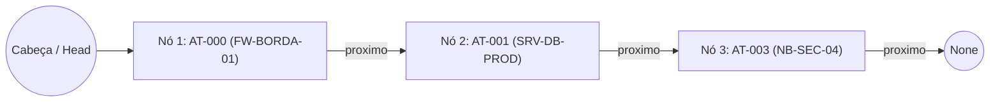

# S3_03 - Estruturas Lineares: Filas e Listas Encadeadas

Implementação prática de Filas (usando `list` e `collections.deque`) e de uma Lista Encadeada Simples aplicadas ao gerenciamento de chamados e ativos de TI.

## Arquivos do módulo

- **`filas_chamados.py`**: Fila de atendimento de vulnerabilidades com `list` e `collections.deque` (Exercícios 1 e 2).
- **`lista_encadeada_ativos.py`**: Lista encadeada simples com operações de inserção, remoção e percurso (Exercícios 3, 4 e 5).

---

## Comparação de Complexidade (Exercício 6)

| Operação                | Fila com `list` | Fila com `collections.deque` | Lista Encadeada Simples |
|:------------------------|:---------------:|:----------------------------:|:-----------------------:|
| **Inserir no início**   |      O(n)       |             O(1)             |          O(1)           |
| **Inserir no fim**      |      O(1)       |             O(1)             |          O(n)           |
| **Remover do início**   |      O(n)       |             O(1)             |          O(1)           |
| **Percorrer elementos** |      O(n)       |             O(n)             |          O(n)           |

- **Resumo:** Na `list` padrão do Python, remover o primeiro da fila com `pop(0)` custa **O(n)** porque todos os outros elementos precisam andar uma casa para trás na memória. Já o `collections.deque` usa `popleft()` com custo **O(1)** (instantâneo). A Lista Encadeada insere e remove no início em **O(1)** apenas trocando os ponteiros, mas exige percorrer nó por nó **O(n)** para buscar itens.

---

## Diagrama da Lista Encadeada (Exercício 7)

Cada **Nó (Node)** guarda os dados do ativo e um ponteiro (`proximo`) que aponta para o próximo equipamento até chegar em `None` (fim da lista):

